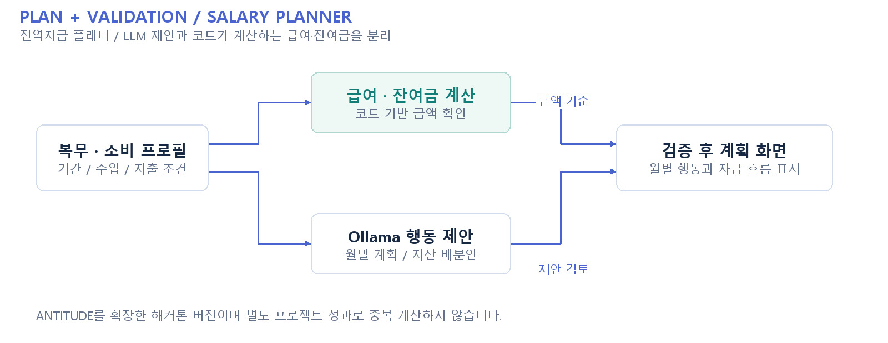

# ANTITUDE / 전역자금 플래너

**ANTITUDE를 국방 주제로 확장한 해커톤 버전**

[구성도 SVG 원본](docs/portfolio/architecture.svg)

## 프로젝트와 담당 범위

5인 팀장으로 서비스 기획·웹 개발·기능 통합을 맡았습니다. 군 복무 프로필과 급여 흐름을 바탕으로 전역 이후 자금 계획을 학습하는 방향으로 확장했습니다. `salaryAi.service.ts`는 Ollama 응답을 검증하고 월별 행동·배분안을 정리합니다. 금액·잔여금 계산은 코드에서 확인합니다.

## 구현 근거

[자금 계획 서비스](server/src/services/salaryAi.service.ts) · [프런트 API](app/src/services/salaryPlanner.service.ts)

기존 설치·구현 문서는 [README_DETAILS.md](README_DETAILS.md)에 보존했습니다.
